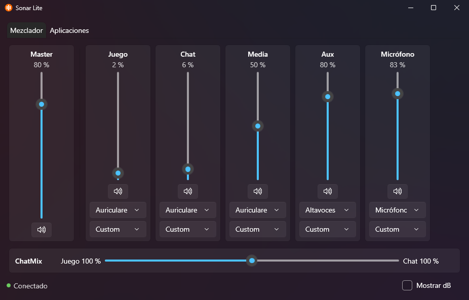
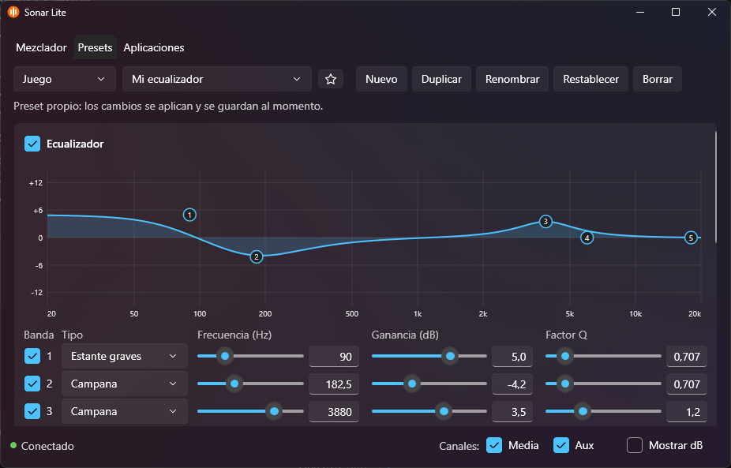
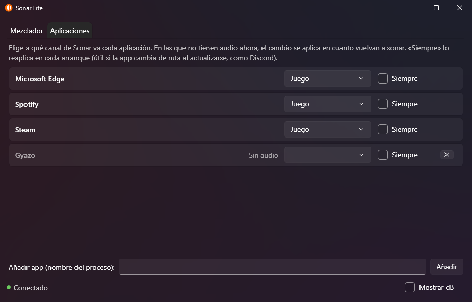

# Sonar Lite

Sustituto ligero de la app SteelSeries GG para controlar **Sonar**. Reutiliza el driver,
el APO y el backend oficial (`SteelSeriesSonar.exe`), pero sin GGEZ / GG / Engine / Prism:
la app hace de "GG" para Sonar y ofrece su propia interfaz en la bandeja del sistema.

| | GG oficial | Sonar Lite |
|---|---|---|
| Procesos | 5 | 2 (SonarLite + SteelSeriesSonar) |
| RAM (working set) | ~900 MB | ~120 MB en reposo |







## Requisitos

- Windows 10/11 con **SteelSeries GG instalado** (Sonar Lite usa su `SteelSeriesSonar.exe`, su driver y su APO).
- [.NET 10 SDK](https://dotnet.microsoft.com/download) para compilar.

## Uso

```powershell
scripts\publish.ps1        # compila y publica en %LOCALAPPDATA%\Programs\SonarLite
```

- Al arrancar cierra GG si está abierto y lanza Sonar contra el GG embebido.
- Icono de bandeja: clic = abrir; menú = reiniciar Sonar, **Iniciar con Windows (en lugar de GG)**,
  **Volver a SteelSeries GG** (p. ej. para actualizar firmware) y Salir.
- `SonarLite.exe --minimized` arranca solo en la bandeja; `SonarLite.exe --exit` cierra la
  instancia en marcha limpiamente.
- Logs: `%LOCALAPPDATA%\SonarLite\logs\` (`sonarlite.log` y `sonar.log`).

Funciones: volumen y mute de master y de los 5 canales (en % o en dB reales), ChatMix,
dispositivo físico de cada canal, preset de EQ por canal, edición y gestión de presets, enrutado
de aplicaciones a canales y desactivación de canales.

### Presets

- La pestaña "Presets" edita el preset seleccionado del canal elegido. Los cambios se aplican y se
  guardan al momento, como en GG.
- Ecualizador paramétrico de 10 bandas en todos los canales: cada banda se activa o desactiva y
  tiene tipo (campana, estante de graves o de agudos, paso bajo, paso alto o rechazo), frecuencia
  (20–20000 Hz), ganancia (±12 dB) y factor Q (0,5–10), con deslizador y casilla para escribir el
  valor. La curva de respuesta se dibuja encima: arrastra un punto para mover su banda y usa la
  rueda del ratón para cambiar su Q.
- Juego, Media y Aux: refuerzos de graves, voz y agudos, audio espacial (auriculares o
  altavoces), aumento de volumen y Smart Volume.
- Chat y Micrófono: cancelación de ruido IA (ClearCast), reducción de ruido de fondo y de
  impactos, puerta de ruido (con umbral automático) y estabilizador de volumen.
- Nuevo, Duplicar, Renombrar, Restablecer, Borrar y favorito (★, salen primero en las listas).
  Los presets de SteelSeries se pueden editar y restablecer, pero no renombrar ni borrar.

### Desactivar canales

- Las casillas **Canales: Media / Aux** de la barra inferior activan o desactivan esos canales,
  igual que en GG (Juego, Chat y Micrófono no se pueden desactivar).
- Un canal desactivado desaparece del mezclador, de la lista de canales de "Aplicaciones" y del
  panel de sonido de Windows (Sonar oculta su dispositivo virtual).
- Sonar lo guarda en su base de datos y lo respeta al reiniciarse; también si el dispositivo se
  desactiva desde el panel de sonido de Windows.

### Enrutado de aplicaciones

- La pestaña "Aplicaciones" lista las apps que suenan ahora y las que han sonado antes (o que
  añadas por nombre de proceso).
- En una app **sin audio**, elegir canal deja un cambio pendiente: se aplica en cuanto la app abra
  su sesión de audio, que es el primer momento en que Windows acepta el cambio.
- Algunas apps no se mueven mientras suenan; la fila lo indica y Windows aplicará el canal al
  reiniciarlas (lo recuerda por ruta del ejecutable).
- **Siempre**: reaplica el canal en cada arranque. Útil para apps que cambian de ruta al
  actualizarse (Discord instala cada versión en `app-x.y.z`, y Windows pierde el canal).

## Limitaciones conocidas

- **Rueda física de ChatMix** del casco: llega vía SteelSeries Engine, que no se ejecuta.
- La curva del ecualizador no incluye los refuerzos de graves, voz y agudos: el APO los aplica
  aparte y su forma no se conoce.
- El enrutado por app es solo de salida (no micrófono).

## Estructura

- `src/SonarLite.Core` — `GgHost` (GG mínimo), `SonarProcess` (lanza/vigila Sonar), `SonarClient` (API REST).
- `src/SonarLite` — app WPF de bandeja.
- `src/FakeGG` + `scripts/*-headless.ps1` — modo sin interfaz, para pruebas.
- `docs/sonar-api.md` — arquitectura de Sonar y mapa de su API.
- `_decompiled/` — referencia local del código de SteelSeries (ignorado por git, no redistribuir).

## Aviso

Proyecto no oficial, sin relación con SteelSeries ni respaldado por ella. "SteelSeries", "GG" y
"Sonar" son marcas de sus respectivos propietarios. Este repositorio no incluye ni redistribuye
software de SteelSeries; necesita una instalación existente de GG.

## Licencia

[MIT](LICENSE).
